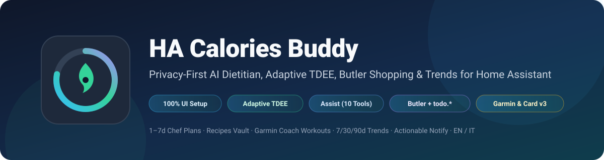
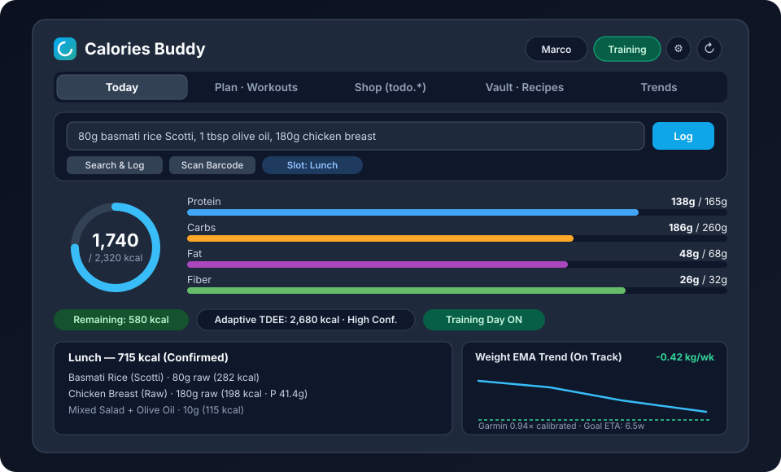
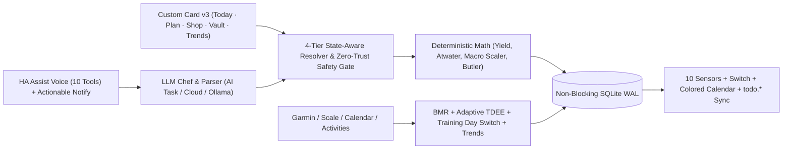

<p align="center">
  
</p>

<p align="center">
  <a href="https://github.com/nicobarlaba/ha-calories-buddy/actions/workflows/hacs.yaml"></a>
  <a href="https://github.com/nicobarlaba/ha-calories-buddy/actions/workflows/hassfest.yaml"></a>
  <a href="https://github.com/nicobarlaba/ha-calories-buddy/actions/workflows/tests.yaml"></a>
  
  
  
</p>

<p align="center">
  <a href="https://my.home-assistant.io/redirect/hacs_repository/?owner=nicobarlaba&amp;repository=ha-calories-buddy&amp;category=integration">
    
  </a>
</p>

**HA Calories Buddy** is a privacy-first, multi-person, AI-assisted **personal dietitian, food diary, workout-aware planner, and smart shopping hub** built natively as a Home Assistant Custom Integration (`100% UI Config Flow` — zero YAML required) with an auto-registered Lovelace Custom Card.

Log meals naturally by voice (**Home Assistant Assist**), free text, manual search, or **EAN barcode scan**—backed by **100% deterministic Python nutrition math**, EU/US Atwater label validation, raw-vs-cooked yield conversion, **Adaptive Closed-Loop TDEE** (`EMA Weight + Fat/Lean Body Comp`), and direct biophysical/workout mapping (Garmin Connect, Garmin Coach calendars, smart scales, and `todo.*` shopping lists).

---

## Key Features

- **100% Graphical UI Configuration (1 Household Hub + N Person Profiles):** Add your Household Hub and any number of Person Profiles via **Settings → Devices & Services → + Add Integration**, auto-matching `person.*` / `user_id`s so voice and dashboard actions route seamlessly.
- **LLM as Chef & Parser, Python as Source of Truth:** Supports **Home Assistant AI Task (`ai_task.*`)** (reuse any existing HA AI integration with zero extra API keys), **OpenAI**, **Anthropic (Claude)**, **Google Gemini**, **Ollama**, and **OpenAI-Compatible** endpoints (LM Studio, OpenRouter, vLLM, Groq) with automatic JSON schema-repair retries—or `none` for 100% offline manual & barcode usage.
- **Hybrid Closed-Loop Adaptive TDEE (`adaptive`):**
  - Combines **EMA weight trend** (`alpha = 0.12`) and optional **two-compartment Fat Mass / Lean Mass EMA** calibration (`9400 kcal/kg FM + 1800 kcal/kg LM` with BIA anti-noise guardrail) over a 14–28d window (`>= 70%` logged adherence, clamped to `±75 kcal/week` max drift).
  - Automatically calibrates your Garmin/wearable multiplier (`[0.65, 1.35]`) and gracefully falls back to `wearable_dynamic` (7-day rolling baseline) or `static` during bootstrap.
- **The Butler — Smart Editable Shopping List & `todo.*` Sync:** Generates an aisle-grouped, editable shopping draft across any date range (with optional multi-person **household merge**), skipping already-logged meals, converting cooked recipe weights back to raw purchase weights via `yield_factor`, converting whole eggs to `pcs`/`pz`, applying preferred brands, and pushing checked items to your HA `todo.*` entity without duplicating active list items.
- **Workout Schedule, Garmin Coach Sync & `switch.*_training_day`:** Track a recurring Mon–Sun workout schedule, connect a `calendar.*` entity (e.g. `calendar.connect_*_scheduled_workouts`) and a recent-activities `sensor.*` (e.g. `sensor.connect_*_last_activities`), toggle `switch.calories_buddy_<name>_training_day` to switch manual Training/Rest macro targets, and automatically inform the AI Meal Planner about upcoming training sessions.
- **Native 7 / 30 / 90-Day Trends SVG Charts:** Inspect *Expected vs Actual* weekly weight change, goal ETA (`target_weight_kg` / `target_body_fat_pct`), daily calories vs target, raw + EMA weight with **Body Fat %** & **Lean Mass kg** toggles, Adaptive TDEE trajectory, and macro/fiber adherence averages.
- **Two-Tier Food Vault & Homemade Composite Recipes:** 88 bilingual IT/EN staples + **Personal Food Overrides** + **Homemade Recipes** compiled from Vault ingredients + **Open Food Facts** barcode lookup & optional **USDA** fallback + **Last-Resort AI Estimate** with **Companion App Actionable Notifications** (*Confirm* / *Delete* / *Undo*).
- **Unified Color-Coded Calendars, 10 Sensors + 1 Switch per Person & 10 Assist Tools:** Full Home Assistant Assist control (`log_meal`, `correct_last_meal`, `suggest_meal`, `generate_meal_plan`, `swap_plan_meal`, `rebalance_today`, `manage_shopping_list`, `get_nutrition_trends`, `manage_workouts`, `get_today_nutrition_summary`) plus 22 services.

---

## Custom Card v3 Preview

<p align="center">
  
</p>

---

## How It Works



---

## Quick Start

### 1. One-Click Install via My Home Assistant (Marketplace / HACS)

Click the button below to add the custom repository directly inside **Home Assistant Marketplace (2026.11+)** or **HACS**:

[](https://my.home-assistant.io/redirect/hacs_repository/?owner=nicobarlaba&repository=ha-calories-buddy&category=integration)

<details>
<summary>Manual Marketplace / HACS steps</summary>

1. Go to **Settings → Marketplace** (or **HACS**) → `⋮` → **Custom repositories**.
2. Add `https://github.com/nicobarlaba/ha-calories-buddy` with category **Integration**.
3. Download **HA Calories Buddy** and **restart Home Assistant**.

*(Or copy `custom_components/ha_calories_buddy` into `<ha_config>/custom_components/ha_calories_buddy` and restart HA.)*

</details>

### 2. Configure Hub & Persons (100% UI)
1. **Settings → Devices & Services → + Add Integration → HA Calories Buddy**:
   - First run sets up the **Household Hub** (default language, shared LLM provider / HA `ai_task.*`, optional USDA key, household baseline notes).
   - Each subsequent **+ Add Integration → HA Calories Buddy** adds a **Person Profile** mapped to `person.*` / `user_id`, biometrics/goals (plus optional `target_weight_kg` / `target_body_fat_pct`), optional Garmin/scale/calendar/activities/todo/notify entities, and dietary constraints.
2. Add the auto-registered card to any dashboard (`type: custom:ha-calories-buddy-card`).

> Full step-by-step instructions, LLM provider tables, Assist voice examples, service schemas, and troubleshooting live in the **[User & Operator Manual](docs/USER_MANUAL.md)**.

---

## Documentation

| Document | Description |
| :--- | :--- |
| [User & Operator Manual](docs/USER_MANUAL.md) | Complete installation, setup, Adaptive TDEE, Butler Shopping, Workouts, Trends, Assist voice, and services guide. |
| [Software Requirements (SRS)](docs/REQUIREMENTS.md) | Functional & non-functional requirements across Phases 1–3. |
| [Technical Architecture](docs/ARCHITECTURE.md) | Hexagonal core boundary, SQLite schema, TDEE math, and HA adapter design. |

---

## Roadmap

| Phase | Scope | Status |
| :--- | :--- | :--- |
| **Phase 1 — MVP** | Multi-person Hub + Person ConfigFlow, SQLite two-tier Food Vault, Open Food Facts + Barcode scanner, EU/US Atwater & raw/cooked yield math, Cloud + Local LLMs, Assist `llm.API`, BMR/TDEE + Garmin/scale mapping, Sensors + Colored Calendar, Custom Card v1 (`en`/`it`). | **Completed (`v0.1.0`)** |
| **Phase 2 — Dietitian & Chef** | Two-tier taste/brand preference learning + Zero-Trust Hard-Constraint Gate, HA `ai_task.*` provider, full Fiber tracking (10 sensors), semantic N-slot planning & multi-course meals, 1-tap grouped slot diary, inline ingredient add/swap/remove, dynamic Garmin biometrics footer, HTTP Photo Barcode decoder, deterministic `±5%` macro-scaled 1–7d meal plans (`meal_prep_mode`), dynamic plan ↔ logged-meal sync, Homemade Composite Recipes (`Ricette di Casa`), paginated Food Vault (88 seeded staples), Macro Pie Chart, realtime Assist↔Card event sync, 7 Assist tools, 18 services. | **Completed (`v0.2.6`)** |
| **Phase 3 — Butler, Workouts & Adaptive TDEE** | Editable grocery draft + `yield_factor` cooked→raw conversion + household merge + deduplicated `todo.*` sync (**The Butler**), closed-loop Hybrid **Adaptive TDEE** (`adaptive` with EMA weight/fat/lean calibration & Garmin multiplier auto-tuning), **Workouts Planner** + `calendar.*` Garmin Coach + `last_activities` sync + `switch.*_training_day`, native SVG **Trends View (`7/30/90d`)**, studio-grade Custom Card v3 UI/UX restyle (5 tabs + header `⚙️`), Companion App actionable notifications, Hub baseline notes prompt injection, 10 Assist tools, 22 services, plus HACS/Hassfest CI & `brand/` public readiness. | **Completed (`v0.3.0`)** |

---

## Development & Verification

```bash
uv venv --python 3.14 .venv
uv pip install --python .venv/bin/python -r requirements.txt -r requirements-dev.txt

.venv/bin/ruff check custom_components tests
.venv/bin/mypy custom_components/ha_calories_buddy/core
.venv/bin/pytest tests/core --cov=custom_components/ha_calories_buddy/core --cov-report=term-missing
.venv/bin/pytest tests/integration -v
```

---

## Disclaimer & License

HA Calories Buddy is a personal nutrition tracking assistant and does not substitute for medical or clinical dietetic advice. Released under the [MIT License](LICENSE).
