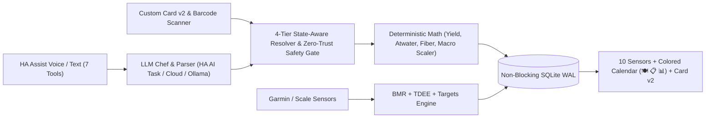

<p align="center">
  
</p>

<p align="center">
  
  
  
  
  
</p>

**HA Calories Buddy** is a privacy-first, multi-person, AI-assisted **personal dietitian, food diary, and nutrition hub** built natively as a Home Assistant Custom Integration with an auto-registered Lovelace Custom Card.

Log meals naturally by voice (**Home Assistant Assist**), free text, manual search, or **EAN barcode scan**—backed by **100% deterministic Python nutrition math**, EU/US Atwater label validation, raw-vs-cooked yield conversion, and direct biophysical sensor mapping (Garmin Connect, smart scales).

---

## Key Features

- **1 Household Hub + N Person Profiles:** Instantiate one isolated profile per household member, mapped directly to Home Assistant `person.*` entities and `user_id`s so voice and dashboard actions route automatically.
- **LLM as Chef & Parser, Python as Source of Truth:** Supports **Home Assistant AI Task (`ai_task.*`)** (reuse any official HA AI integration with zero duplicated API keys), **OpenAI**, **Anthropic (Claude)**, **Google Gemini**, **Ollama**, and **OpenAI-Compatible** endpoints (LM Studio, OpenRouter, vLLM, Groq) with automatic JSON schema-repair retries—or `none` for 100% offline manual & barcode usage. LLMs never calculate final calories or sum macros.
- **4-Tier Food Resolution Waterfall & Paginated Two-Tier Food Vault:**
  1. **Personal Food Overrides** (custom macros, preferred aliases, personal portions like `tbsp=12g`, custom yield factors)
  2. **Global Household Food Vault** (non-blocking SQLite WAL storage with 68 bilingual IT/EN staples, category filters, state-aware raw/cooked ranking, and full pagination)
  3. **Open Food Facts** (barcodes & branded EU/Italian products) + optional **USDA FoodData Central**
  4. **Last-Resort AI Estimate** (explicitly flagged for 1-tap confirmation and optional Vault promotion)
- **Raw ↔ Cooked Precision, Fiber & Atwater Guardrails:** Handles dry vs. cooked weight conversions (`rice 2.5x`, `pasta 2.2x`, `legumes 2.4x`, `poultry 0.75x`), prioritizes exact preparation state matches, tracks **dietary fiber (`g`)** end-to-end (`14g / 1000 kcal` clamped `20–45g` physiological default or manual overrides), validates labels against EU/US Atwater factors ($4P + 4C + 9F + 2\text{Fiber}$), and normalizes ambiguous meal slots deterministically by time of day.
- **AI Dietitian & Chef (Phase 2):** Two-tier **Global Household + Personal Preference Engine** with a deterministic **Zero-Trust Hard-Constraint Gate** for allergies, intolerances, blacklists, and dietary regimes (`vegan`, `vegetarian`, `pescatarian`, `keto`, etc.); on-demand `Suggest Meal`; 1–7 day macro-scaled meal plans (with optional **Meal Prep Batch Mode**) accurate within `±5%`; 1-tap meal promotion (`Eaten`) and single-slot swap; plus intra-day & multi-day dynamic rebalancing honoring strict physiological calorie/fat floors.
- **Physiology & Wearable Integration (Energy-Dashboard Style):** Map existing HA sensors for weight (`kg`/`lb`), body fat `%`, Garmin active/total calories (`kcal`/`kJ`), steps, `todo.*` shopping lists, and `notify.*` services. Uses Katch-McArdle / Mifflin-St Jeor BMR and a **7-day completed-day wearable baseline**, plus full **Manual / Nutritionist Mode** with rest/training targets.
- **Unified Color-Coded Calendars & 10 Sensors per Person:** Each person gets a distinct colored `calendar` entity projecting logged meals (`🍽️`, slot-anchored), planned meals (`📋`), and daily summaries (`📊`), plus 10 sensors (`calories_consumed`, `calories_target`, `calories_remaining`, protein, carbs, fat, `fiber_consumed`, `tdee`, `pending_confirmations`, `daily_adherence_pct`).
- **Auto-Registered Custom Card v2 (`en` / `it`):** Zero-build modular ES Web Component card with 4 views (**Today**, **Plan**, **Food Vault**, **Preferences**), inline SVG **Macro Distribution Donut Chart** (*Consumed* vs. *Target*), 1-tap inline meal-slot pills, live EAN barcode scanner, hybrid confirmation workflow, and paginated Food Vault browsing.

---

## Custom Card Preview

<p align="center">
  
</p>

---

## How It Works



---

## Quick Start

### 1. Install via Home Assistant Marketplace / HACS
1. Go to **Settings → Marketplace** (or **HACS**) → `⋮` → **Custom repositories**.
2. Add `https://github.com/nicobarlaba/ha-calories-buddy` with category **Integration**.
3. Download **HA Calories Buddy** and **restart Home Assistant**.

*(Or manually copy `custom_components/ha_calories_buddy` into `<ha_config>/custom_components/ha_calories_buddy` and restart HA.)*

### 2. Configure Hub & Persons
1. **Settings → Devices & Services → + Add Integration → HA Calories Buddy**:
   - First run sets up the **Household Hub** (default language, shared LLM provider, optional USDA key).
   - Each subsequent **+ Add Integration → HA Calories Buddy** adds a **Person Profile** mapped to `person.*` / `user_id`, biometrics/targets, and optional Garmin/scale sensors.
2. Add the auto-registered card to any dashboard (`type: custom:ha-calories-buddy-card`).

> Full step-by-step instructions, LLM provider tables, Assist voice examples, service schemas, and troubleshooting live in the **[User & Operator Manual](docs/USER_MANUAL.md)**.

---

## Documentation

| Document | Description |
| :--- | :--- |
| [User & Operator Manual](docs/USER_MANUAL.md) | Complete installation, setup, LLM config, sensor mapping, Assist voice, barcode, and services guide. |
| [Software Requirements (SRS)](docs/REQUIREMENTS.md) | Functional & non-functional requirements across Phases 1–3. |
| [Technical Architecture](docs/ARCHITECTURE.md) | Hexagonal core boundary, SQLite schema, TDEE math, and HA adapter design. |

---

## Roadmap

| Phase | Scope | Status |
| :--- | :--- | :--- |
| **Phase 1 — MVP** | Multi-person Hub + Person ConfigFlow, SQLite two-tier Food Vault, Open Food Facts + Barcode scanner, EU/US Atwater & raw/cooked yield math, Cloud + Local LLMs, Assist `llm.API`, BMR/TDEE + Garmin/scale mapping, Sensors + Colored Calendar, Custom Card v1 (`en`/`it`). | **Completed (`v0.1.0`)** |
| **Phase 2 — Dietitian & Chef** | Two-tier taste/brand preference learning + Zero-Trust Hard-Constraint Gate, HA `ai_task.*` LLM provider, full Fiber tracking (10 sensors), on-demand recipe proposals, deterministic `±5%` macro-scaled 1–7d meal plans (`meal_prep_mode`), swap/promote, intra-day & multi-day rebalancing, Paginated Vault, Macro Pie Chart, 7 Assist tools, 14 services, Custom Card v2 (`Today`, `Plan`, `Food Vault`, `Preferences`). | **Completed (`v0.2.0`)** |
| **Phase 3 — Butler & Adaptive TDEE** | Editable weekly shopping draft synced to `todo.*`, MacroFactor-style Adaptive TDEE (EMA weight trend vs. intake), composite homemade recipes, Trends SVG charts. | Planned |

---

## Development & Verification

```bash
uv venv --python 3.14 .venv
uv pip install --python .venv/bin/python -r requirements.txt -r requirements-dev.txt

.venv/bin/ruff check custom_components tests
.venv/bin/mypy custom_components/ha_calories_buddy/core
.venv/bin/pytest tests/core --cov=custom_components/ha_calories_buddy/core --cov-report=term-missing
.venv/bin/pytest tests/integration -v
```

---

## Disclaimer & License

HA Calories Buddy is a personal nutrition tracking assistant and does not substitute for medical or clinical dietetic advice. Released under the [MIT License](LICENSE).
