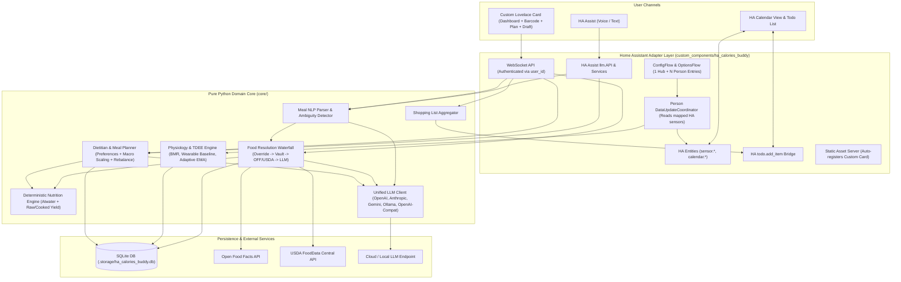
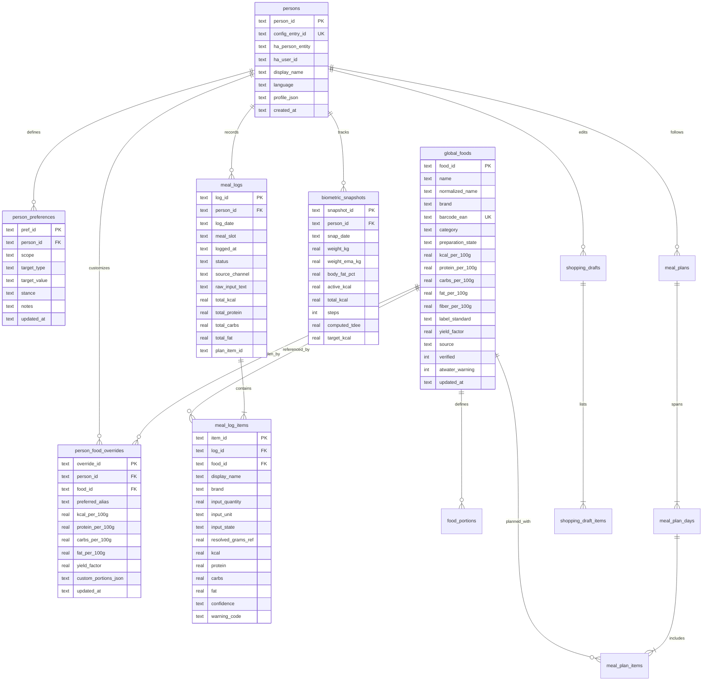
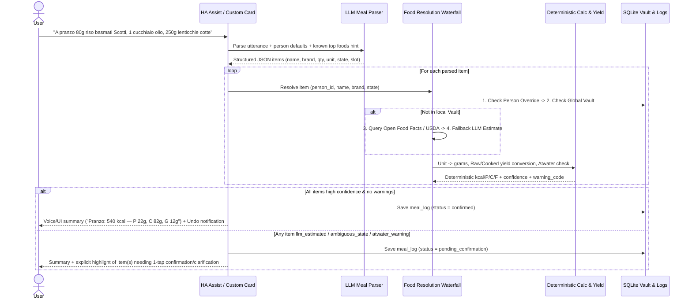

# ha-calories-buddy — Technical Architecture & Design

**Version:** 0.1 (Baseline for Review)  
**Date:** 2026-11-25  
**Companion Document:** [REQUIREMENTS.md](file:///home/nico/script/ha-calories-buddy/docs/REQUIREMENTS.md)

---

## 1. Architectural Principles

1. **Strict Separation of Concerns (Hexagonal / Clean Architecture):**
   - The **Core Domain (`core/`)** is pure, async Python with **zero imports from `homeassistant`**. It owns nutrition math, yield conversion, Atwater validation, physiology/TDEE engines, SQLite repositories, external food database clients, LLM providers/parsers, meal planning, and shopping aggregation.
   - The **Home Assistant Adapter (`custom_components/ha_calories_buddy/`)** is a thin orchestration layer handling Config Entries, Coordinators, HA Entities (`sensor`, `calendar`), Services, Assist (`llm.API`), WebSocket APIs, and static serving of the Custom Card.
   - This enables fast, deterministic `pytest` suites on the entire domain without spinning up HA, while keeping HA integration tests clean and focused.
2. **LLM as Structured Parser & Planner, Python as Source of Truth:**
   - Every calorie, macro sum, raw/cooked conversion, TDEE calculation, and shopping quantity aggregation is computed deterministically in Python.
3. **Single-Package HACS Distribution:**
   - One repository installs both the backend custom integration and the auto-registered Lovelace Custom Card bundle (`ha-calories-buddy-card.js`).
4. **Low-Cardinality Structured Logging:**
   - All modules emit structured logs using fixed message templates and `extra={...}` fields (never concatenating user inputs, API keys, or entity values into message strings).

---

## 2. High-Level System Architecture



---

## 3. Repository & Module Structure

```text
ha-calories-buddy/
├── hacs.json
├── README.md
├── LICENSE
├── requirements.txt                  # Dev/test dependencies (managed in local venv)
├── pyproject.toml                    # ruff, mypy, pytest configuration
├── docs/
│   ├── REQUIREMENTS.md
│   └── ARCHITECTURE.md
├── custom_components/
│   └── ha_calories_buddy/
│       ├── __init__.py               # Integration setup, Hub/Person bootstrap, card registration
│       ├── manifest.json             # HACS/HA manifest & runtime PyPI dependencies
│       ├── const.py                  # Domain constants, defaults, config keys
│       ├── config_flow.py            # Hub ConfigFlow + Person ConfigFlow + OptionsFlow
│       ├── coordinator.py            # Per-person coordinator (HA sensor sync + daily metrics)
│       ├── sensor.py                 # Daily kcal/macros, remaining budget, TDEE, pending count
│       ├── calendar.py               # Per-person CalendarEntity (plan + logs + daily summary)
│       ├── services.py               # HA service handlers (log_meal, lookup_barcode, plan, etc.)
│       ├── services.yaml             # HA service schemas & UI selectors
│       ├── websocket_api.py          # Authenticated WS commands for the Custom Card
│       ├── llm_api.py                # Home Assistant Assist llm.API tool registration
│       ├── frontend.py               # Static path & Lovelace resource auto-registration
│       ├── translations/
│       │   ├── en.json
│       │   └── it.json
│       ├── frontend_dist/
│       │   └── ha-calories-buddy-card.js   # Built single-file Web Component bundle
│       └── core/                     # Pure Python domain (zero HA imports)
│           ├── __init__.py
│           ├── models.py             # Pydantic v2 domain models & schemas
│           ├── storage/
│           │   ├── database.py       # Async SQLite connection & migration runner
│           │   ├── migrations/       # Versioned SQL migrations (001_initial.sql, ...)
│           │   ├── food_repo.py      # Two-tier Food Vault repository
│           │   ├── meal_repo.py      # Meal logs, plans, shopping drafts repository
│           │   ├── profile_repo.py   # Person profile, biometrics, preferences repository
│           │   └── seed_foods.json   # Curated baseline whole foods (raw/cooked + yield factors)
│           ├── nutrition/
│           │   ├── calculator.py     # Deterministic macro math & scaling
│           │   ├── atwater.py        # EU/US Atwater consistency validator
│           │   ├── yield_factors.py  # Raw <-> cooked yield & state ambiguity rules
│           │   ├── units.py          # Household measure & unit conversion engine
│           │   ├── resolver.py       # Waterfall resolver (Override -> Vault -> OFF/USDA -> LLM)
│           │   └── providers/
│           │       ├── base.py
│           │       ├── open_food_facts.py
│           │       └── usda.py
│           ├── physiology/
│           │   ├── bmr.py            # Katch-McArdle & Mifflin-St Jeor
│           │   ├── tdee.py           # Static, Wearable-Dynamic (baseline+delta), Adaptive EMA
│           │   └── targets.py        # Macro allocation & physiological safety guardrails
│           ├── llm/
│           │   ├── base.py           # Abstract LLMClient + structured JSON retry/repair
│           │   ├── factory.py        # Provider factory with per-person override resolution
│           │   ├── openai_compat.py  # OpenAI, LM Studio, OpenRouter, vLLM, Groq, etc.
│           │   ├── anthropic_client.py
│           │   ├── gemini_client.py
│           │   ├── ollama_client.py
│           │   └── prompts/          # Modular, language-aware prompt builders
│           ├── planner/
│           │   ├── preferences.py    # Global + per-person preference merge & log frequency scoring
│           │   ├── meal_parser.py    # NLP utterance -> structured items + hybrid status decision
│           │   ├── meal_planner.py   # Daily/weekly planning, recipe proposals, deterministic scaling
│           │   ├── rebalancer.py     # Intra-day & multi-day budget rebalancing
│           │   └── shopping.py       # Plan ingredient aggregation & draft builder
│           └── i18n/                 # Core domain prompt/message localization (en, it)
├── frontend/                         # Frontend source (Lit + TypeScript + Vite)
│   ├── package.json
│   ├── tsconfig.json
│   ├── vite.config.ts
│   └── src/
│       ├── ha-calories-buddy-card.ts
│       ├── views/                    # today, plan, shopping, vault, trends
│       ├── components/               # macro-rings, barcode-scanner, food-editor, meal-row
│       └── i18n/                     # en.ts, it.ts
└── tests/
    ├── core/                         # Fast unit tests for all core/ modules
    └── integration/                  # Home Assistant component & flow tests
```

> **Note on `core/` placement:** Placing `core/` inside `custom_components/ha_calories_buddy/core/` guarantees HACS distributes the entire integration cleanly as a single folder with zero extra PyPI packaging friction, while maintaining a strict architectural boundary enforced by lint/tests (`core/` never imports `homeassistant`).

---

## 4. Home Assistant Configuration & Identity Resolution

### 4.1 Config Entry Topology
We use a clean **Hub + Person Config Entry** pattern:
1. **Household Hub Entry (`entry_kind = "hub"` — singleton):**
   - Created automatically on first setup.
   - Stores: default LLM provider (`provider`, `base_url`, `api_key`, `model`, `temperature`), default language, optional USDA API key, global household taste baseline.
   - Displays the **LLM Capability & Privacy Disclosure Notice** in the setup/options UI.
2. **Person Profile Entries (`entry_kind = "person"` — 1..N):**
   - Each represents one monitored person (e.g., `Calories Buddy — Marco`).
   - Step 1 (Identity): Select HA `person.*` entity (automatically extracts linked HA `user_id` from `person` attributes, editable if needed) + display name + preferred language (inherit/override).
   - Step 2 (Biometrics & Mode): Sex, birth date, height, initial weight, optional body fat %, Target Mode (`physiology` vs `manual`), goal & TDEE engine.
   - Step 3 (Sensor & Service Mapping — optional `EntitySelector`s): weight sensor, body fat sensor, wearable active/total calories sensors, steps sensor, `todo.*` shopping list, `notify.*` service.
   - Step 4 (LLM Override — optional): inherit Hub LLM or configure custom provider/model for this person.
   - Step 5 (Dietary Constraints & Meal Slots): dietary regime, allergies/intolerances, customizable daily meal slots & max cooking times.

### 4.2 User & Person Routing for Voice (Assist) & Card
When an action arrives:
1. **Custom Card (WebSocket):** `connection.user.id` is provided securely by HA. The backend resolves the Person Profile mapped to that `user_id` (and allows switching view in the card config if an admin/family dashboard displays multiple cards).
2. **HA Assist (`llm.API`) & Services:**
   - Priority 1: Explicit `person` parameter (e.g., spoken *"Log for Giulia..."* or passed in service call).
   - Priority 2: `context.user_id` mapped to a Person Profile.
   - Priority 3: If only one Person Profile exists in HA, select it automatically.
   - Priority 4: If multiple profiles exist and `context.user_id` is absent (e.g., shared smart speaker satellite), return a clear prompt asking which person the meal belongs to (or use a satellite-to-person default if configured).

---

## 5. Database Design (SQLite)

Stored at `<ha_config>/.storage/ha_calories_buddy.db` (WAL mode enabled for safe concurrent async access).



### Key Schema Notes
- `person_preferences.scope`: `'global'` (household baseline, `person_id = NULL`) or `'person'` (overrides global for the same `target_type` + `target_value`). `stance` values: `allergy`, `intolerance`, `blacklist`, `dislike`, `neutral`, `like`, `love`, `preferred_brand`.
- `global_foods.label_standard`: `'eu'` (available carbs) or `'us'` (total carbs including fiber) — guarantees accurate Atwater checks across Open Food Facts EU and USDA entries.
- `meal_logs.status`: `'confirmed'`, `'pending_confirmation'`, `'deleted'` (soft-delete allows quick undo from notifications/card!).
- `meal_plans` & `meal_plan_items`: store planned meals, full recipe steps (`recipe_json`), ingredient list with exact computed grams, and status (`planned`, `consumed`, `skipped`, `replaced`).

---

## 6. Critical Engine Flows

### 6.1 Voice / Text Meal Logging & Hybrid Confirmation Flow



### 6.2 Raw vs. Cooked Conversion & Ambiguity Rules
1. If `input_state == food.preparation_state`:
   $$\text{ref\_grams} = \text{input\_grams}$$
2. If `food.preparation_state == 'raw'` and `input_state == 'cooked'`:
   $$\text{ref\_grams} = \frac{\text{input\_grams}}{\text{yield\_factor}}$$
3. If `food.preparation_state == 'cooked'` and `input_state == 'raw'`:
   $$\text{ref\_grams} = \text{input\_grams} \times \text{yield\_factor}$$
4. If `input_state == 'unspecified'`:
   - Ready-to-eat foods (oil, yogurt, bread, fruit, packaged snacks): treat directly as `ready_to_eat` (`confidence = high`).
   - High-yield-variance foods (legumes, rice, pasta, oats, meat, fish):
     - Apply category default (e.g., pasta/rice → `raw` if `30g <= qty <= 150g`; meat/fish → `raw` if configured) **except** when weight falls outside the plausible default range or category is inherently ambiguous (e.g., legumes: canned cooked vs dry raw) → flag `ambiguous_state`, triggering hybrid confirmation!

### 6.3 Wearable-Dynamic & Adaptive TDEE Architecture
To avoid the classic mid-day cumulative sensor bug and wearable double-counting:
- **End-of-day snapshotting:** At 23:55 (and periodically throughout the day), the coordinator snapshots mapped HA wearable sensors into `biometric_snapshots`.
- **Today's Wearable TDEE baseline:**
  - Computed as the rolling mean of the last 7 *completed* days' `total_kcal` (or `BMR + active_kcal * correction_factor`).
  - During the current day, if live `active_kcal` exceeds the 7-day average active burn (e.g., an unusually long workout), the excess `(today_active - baseline_active) * correction_factor` is added dynamically to today's budget.
- **Adaptive TDEE (Phase 3):**
  - Daily weight EMA: $W_{\text{EMA},t} = \alpha W_t + (1 - \alpha) W_{\text{EMA},t-1}$ ($\alpha = 0.12$).
  - Over rolling window $D \in [14, 28]$ days (only when ≥ 70% days logged and ≥ 4 weigh-ins recorded):
    $$\text{TDEE}_{\text{obs}} = \overline{\text{Intake}}_D - \frac{(W_{\text{EMA},t} - W_{\text{EMA},t-D}) \times 7700}{D}$$
  - New TDEE moves toward $\text{TDEE}_{\text{obs}}$ clamped to at most `±75 kcal/week` for smooth, noise-resistant convergence.

### 6.4 LLM Client Abstraction & Parity Across Cloud and Local Models
To guarantee identical architectural quality across **OpenAI, Anthropic, Gemini, Ollama, and LM Studio / OpenAI-compatible**:
- Unified async interface `LLMClient.generate_structured(system_prompt, user_prompt, response_model: type[T]) -> T`.
- **Native JSON Schema enforcement** where supported (OpenAI `response_format`, Gemini `response_schema`, Ollama `format: schema`, Anthropic tool-use forced JSON).
- **Schema-Repair Loop:** If JSON parsing or Pydantic validation fails (common with smaller local models), retry up to 2 times appending the exact validation error message.
- **Prompt Sizing Discipline:** Keep prompts lean and single-purpose (separate calls for meal parsing vs meal planning vs food estimation fallback) rather than stuffing massive context into a single monolithic prompt.

---

## 7. Home Assistant Exposed Interfaces

### 7.1 Entities (Per Person)
| Domain | Entity Naming Pattern | Description |
| :--- | :--- | :--- |
| `sensor` | `sensor.<slug>_calories_consumed` | Today's confirmed kcal (`state_class: total`, `unit: kcal`, attributes include meal breakdown) |
| `sensor` | `sensor.<slug>_calories_target` | Today's target kcal (attributes: mode, BMR, TDEE, goal, safety warnings) |
| `sensor` | `sensor.<slug>_calories_remaining` | `target - consumed` kcal |
| `sensor` | `sensor.<slug>_protein_consumed` | Today's protein (`g`) + target & remaining attributes |
| `sensor` | `sensor.<slug>_carbs_consumed` | Today's carbs (`g`) + target & remaining attributes |
| `sensor` | `sensor.<slug>_fat_consumed` | Today's fat (`g`) + target & remaining attributes |
| `sensor` | `sensor.<slug>_tdee` | Current effective TDEE (`kcal`) |
| `sensor` | `sensor.<slug>_pending_confirmations` | Count of meals awaiting hybrid confirmation (great trigger for HA automations!) |
| `calendar` | `calendar.<slug>_nutrition` | Unified per-person calendar (planned meals, logged meals, daily all-day summary) |

### 7.2 Services & Assist Tools (`llm.API`)
- `ha_calories_buddy.log_meal_text` — parse and log a natural language meal utterance.
- `ha_calories_buddy.log_meal_item` — deterministic manual/barcode item logging.
- `ha_calories_buddy.confirm_meal` / `update_meal_item` / `delete_meal` — hybrid review and edits.
- `ha_calories_buddy.lookup_barcode` — query Vault / Open Food Facts by EAN.
- `ha_calories_buddy.suggest_meal` — on-demand recipe/meal suggestion fitting remaining macros.
- `ha_calories_buddy.generate_meal_plan` — generate daily or weekly meal plan.
- `ha_calories_buddy.rebalance_plan` — intra-day or multi-day rebalancing.
- `ha_calories_buddy.create_shopping_draft` / `commit_shopping_draft` — generate editable draft & push to mapped `todo.*`.

### 7.3 WebSocket API (For Custom Card)
Namespaced under `ha_calories_buddy/*` (e.g., `get_dashboard`, `log_text`, `confirm_log`, `search_foods`, `lookup_barcode`, `save_food`, `get_plan`, `swap_plan_meal`, `get_shopping_draft`, `commit_shopping_draft`, `get_trends`), authenticated automatically via `connection.user.id`.

---

## 8. Custom Lovelace Card Architecture

- **Tech Stack:** **Lit 3 + TypeScript**, bundled via **Vite** into a single ES module `custom_components/ha_calories_buddy/frontend_dist/ha-calories-buddy-card.js` (zero runtime CDN dependencies, works offline/LAN-only).
- **Auto-Registration (`frontend.py`):** Serves `/ha_calories_buddy/ha-calories-buddy-card.js` via HA `StaticPathConfig` with version cache-busting query string and registers it in Lovelace resources automatically when Lovelace is in storage mode (with clear documentation snippet for YAML mode users).
- **Barcode Scanner Component:**
  - Uses native browser `BarcodeDetector` API where available, falling back to a lightweight bundled WASM/JS decoder (e.g., `@zxing/browser`) for iOS Safari / Companion WebView compatibility.
  - Gracefully detects non-HTTPS contexts and falls back to manual EAN entry or photo upload decoding.
- **Theming:** Uses standard Home Assistant CSS custom properties (`--ha-card-background`, `--primary-color`, `--primary-text-color`, `--success-color`, `--warning-color`) so it matches light, dark, and custom HA themes seamlessly.

---

## 9. Development, Testing & Quality Strategy

- **Python Environment:** Isolated local `.venv` with pinned dev/test dependencies in `requirements.txt`.
- **Unit Test Suite (`tests/core/`):**
  - 100% deterministic tests for Atwater EU/US math, raw↔cooked yield conversions, ambiguity detection, BMR/TDEE/wearable baseline/adaptive EMA, macro guardrails, two-tier food/preference resolution, shopping aggregation, and LLM structured-output repair logic (with mocked HTTP/LLM responses).
- **HA Integration Tests (`tests/integration/`):**
  - Using `pytest-homeassistant-custom-component`: Hub + multi-person ConfigFlow, OptionsFlow, `user_id` routing, coordinator entity mapping & `unavailable` fallback, calendar event projection, Assist tool invocations, and WebSocket API permissions.
- **Code Quality Gates:** `ruff` (PEP 8 + import sorting), `mypy` (static typing), `pytest --cov`, and HACS/`hassfest` manifest/translation validation before each milestone.
